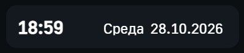

# 📅 Виджет `wgtCurrentDateTime`

> Визуальное отображение текущих даты, времени и дня недели.

---

## 📦 Зависимости

| Библиотека | Комментарий                                                                 |
| ---------- | --------------------------------------------------------------------------- |
| `ATOM`     | Цвета, шрифт                                                                |
| `FUNC`     | Функция [`dayOfWeek`](../FUNC/dayOfWeek.md) — вычисление дня недели         |

---

## 📝 Примечания

- Для получения текущей даты используется программа `getNowTime`, в которой используется системная функция [`GET_TIME`](https://support.mps-soft.ru/Help-web/index.html?get_time.html).
- Способ исполнения: **периодический**.
- Рекомендуется назначить объекту отдельную задачу исполнения с периодом **1000 мс** — иначе виджет будет обновляться с периодичностью главной задачи.
